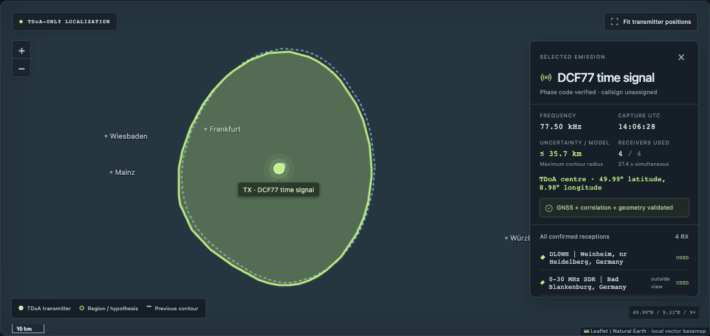

# Meridian TDoA Observatory

**Put radio signals on the map.**

Meridian is an open-source web app for exploring where radio signals come from. It compares when the **same transmission** reaches several synchronized software-defined radio (SDR) receivers, then displays possible source locations on an interactive map.

Built for **public radio beacons** and **participating amateur-radio stations**, using **Time Difference of Arrival (TDoA)**.

[](https://github.com/s1lviu/meridian-tdoa/actions/workflows/ci.yml)

[Quick start](#quick-start) · [Deploy](#deploy) · [Documentation](#documentation) · [Contribute](CONTRIBUTING.md)



*DCF77 on 27 November 2026. The green TX marker and contour come from the measured arrival-time differences. The inspector shows the UTC observation time and the model radius.*

## What you can do

- **Find a transmitter on the live map.** Select a callsign above the map to zoom to its TDoA contour and see the estimated coordinates, UTC time and model uncertainty. Selecting a reference beacon follows new observations of that beacon on the same band. **Heard without a unique position** lists the unresolved signals and their receiver counts. [Follow DCF77 live](http://localhost:3000/?station=DCF77)
- **Watch FT8 and WSPR across bands at the same time.** Enable **Show reception activity** to see public reports by the transmitter's two-letter Maidenhead field (20° longitude by 10° latitude). Select a field, mode or band to see recent activity. The digital layer uses a single shared subscription to PSK Reporter and the WSPR reporting networks. TDoA markers come from Meridian's synchronized IQ captures. [Live feed](https://www.mqtt.pskreporter.info/)
- **Follow 18 amateur beacons across five HF bands.** The world view shows the current UTC schedule, eligible KiwiSDRs and verified observations. Click a band or a heard callsign to inspect its receivers. Each map contour comes from a single transmission. The live monitor also measures DCF77 on LF. [International Beacon Project](https://www.ncdxf.org/beacon/)
- **Compare positions and accuracy.** Inspect successive observations of the same signal on the same band or compare three receivers with the full network on the same samples. The worldwide band table reports verified slots, unique fixes, ambiguity, median error and P90 for the selected interval.
- **Explore the map.** Pan and zoom to find transmissions whose estimated regions overlap your view.
- **Find a specific observation.** Filter by frequency band and UTC time range.
- **Inspect the evidence.** Select a transmission to see its frequency, capture time and every confirmed receiver, including those outside the map view.
- **Understand the result.** See uncertainty regions and which receivers contributed to the calculation. Callsigns appear only when supported by evidence for that transmission.
- **Replay and compare.** Revisit saved recordings, run a synchronization-loss check, or request a new capture as an administrator. Live and replay data are labeled separately.

## How it works

1. **Receive** — Independent KiwiSDR receivers record the same signal at the same time, using a shared time reference.
2. **Compare** — The Rust backend measures the small differences in arrival time between receivers.
3. **Map** — Those differences constrain the transmitter's possible location. Meridian plots the resulting regions and receiving stations.

An estimate needs at least **three synchronized receivers** with suitable geometry. When timing, signal agreement or geometry cannot support a location, the app shows **Position undetermined**. Ambiguous results show multiple possible regions.

Meridian uses KiwiSDR receivers that support synchronized signal recordings and allow automated access. [Read about receiver checks →](docs/LIVE-SOURCES.md)

## Quick start

### Live on your own machine

With Rust, a C toolchain and Python installed, run these commands from the repository root.

```sh
./scripts/setup_kiwiclient.sh
. .venv/bin/activate
MERIDIAN_CONFIG=config/production.json cargo run --release --locked
```

Open [the live map](http://localhost:3000/). The server receives FT8 and WSPR reports continuously and records two public beacon channels in parallel using disjoint SDR groups, even with the browser closed. This hosting profile listens on all interfaces. Set its `listen` field to `127.0.0.1:3000` in a local copy for loopback-only access. New IQ and results are stored under `data/`. [Capture cadence, storage and native configuration](docs/PRODUCTION.md#scheduled-public-observatory)

### Explore the bundled recording

With **Docker** installed, run:

```sh
git clone https://github.com/s1lviu/meridian-tdoa.git
cd meridian-tdoa
docker build -t meridian-tdoa:0.2.0 .
docker run --rm --init -p 3000:3000 \
  -e MERIDIAN_CONFIG=/app/config/app.json \
  -v meridian-data:/app/data meridian-tdoa:0.2.0
```

Open **[localhost:3000](http://localhost:3000/?replay=1)**.

This setup opens a replay of a **real DCF77 recording from three receivers**. Explore the map, inspect the recording, or select **Test GNSS loss** to see how losing synchronization changes the result. No SDR account or map API key is needed for the included replay.

Prefer a native build? See the [development guide](docs/DEVELOPMENT.md).

## Deploy

[](https://render.com/deploy?repo=https://github.com/s1lviu/meridian-tdoa)

The repository includes a Dockerfile and a **Render Free** Blueprint. Render provides the public URL and HTTPS; the [setup guide](docs/RENDER.md) walks through deployment and administrator access.

Render Free uses temporary storage. To keep new captures across restarts, follow the [persistent storage instructions](docs/RENDER.md#persistent-storage). For other providers, see the [hosting comparison](docs/HOSTING.md).

## Documentation

| I want to… | Read |
|---|---|
| Configure receivers, capture and storage | [Deployment and operation](docs/PRODUCTION.md) |
| Integrate with the backend | [API reference](docs/API.md) |
| Build, test or import another recording | [Development guide](docs/DEVELOPMENT.md) |
| Understand the measurements and their limits | [Method and validation](docs/VALIDATION.md) |
| Check receiver access and source provenance | [Live sources](docs/LIVE-SOURCES.md) |

## Contributing and license

Built with **Rust · Axum · Leaflet · KiwiClient**. See [CONTRIBUTING.md](CONTRIBUTING.md) for development guidelines.

Licensed under **[GPL-3.0-or-later](LICENSE)**. Bundled recordings, libraries and map data retain their original licenses; see [third-party notices](THIRD_PARTY.md).
