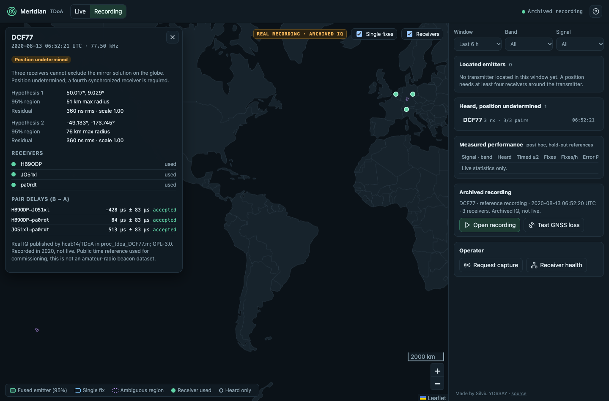

# Meridian TDoA Observatory

**Put radio signals on the map.**

Meridian is an open-source web app for exploring where radio signals come from. It compares when the **same transmission** reaches several synchronized software-defined radio (SDR) receivers, then displays possible source locations on an interactive map.

Built for **public radio beacons** and **participating amateur-radio stations**, using **Time Difference of Arrival (TDoA)**.

[](https://github.com/s1lviu/meridian-tdoa/actions/workflows/ci.yml)

[Quick start](#quick-start) · [Deploy](#deploy) · [Documentation](#documentation) · [Contribute](CONTRIBUTING.md)



*The included DCF77 recording, replayed with receiver details and possible source regions.*

## What you can do

- **Explore the map.** Pan and zoom to find transmissions whose estimated regions overlap your view.
- **Find a specific observation.** Filter by frequency band and UTC time range.
- **Inspect the evidence.** Select a transmission to see its frequency, capture time and every confirmed receiver, including those outside the map view.
- **Understand the result.** See uncertainty regions and which receivers contributed to the calculation. Callsigns appear only when supported by evidence for that transmission.
- **Replay and compare.** Revisit saved recordings, run a synchronization-loss check, or request a new capture as an administrator. Live and replay data are labeled separately.

## How it works

1. **Receive** — Independent KiwiSDR receivers record the same signal at the same time, using a shared time reference.
2. **Compare** — The Rust backend measures the small differences in arrival time between receivers.
3. **Map** — Those differences constrain the transmitter's possible location. Meridian plots the resulting regions and receiving stations.

An estimate needs at least **three synchronized receivers** with suitable geometry. When timing, signal agreement or geometry cannot support a location, the app shows **Position undetermined**. Ambiguous results show multiple possible regions.

Meridian uses KiwiSDR receivers that support synchronized signal recordings and allow automated access. [Read about receiver checks →](docs/LIVE-SOURCES.md)

## Quick start

With **Docker** installed, run:

```sh
git clone https://github.com/s1lviu/meridian-tdoa.git
cd meridian-tdoa
docker build -t meridian-tdoa:0.2.0 .
docker run --rm --init -p 3000:3000 \
  -e MERIDIAN_CONFIG=/app/config/app.json \
  -v meridian-data:/app/data meridian-tdoa:0.2.0
```

Open **[localhost:3000](http://localhost:3000/?replay=1)**.

This setup opens a replay of a **real DCF77 recording from three receivers**. Explore the map, inspect the recording, or select **Test GNSS loss** to see how losing synchronization changes the result. No SDR account or map API key is needed for the included replay.

Prefer a native build? See the [development guide](docs/DEVELOPMENT.md).

## Deploy

[](https://render.com/deploy?repo=https://github.com/s1lviu/meridian-tdoa)

The repository includes a Dockerfile and a **Render Free** Blueprint. Render provides the public URL and HTTPS; the [setup guide](docs/RENDER.md) walks through deployment and administrator access.

Render Free uses temporary storage. To keep new captures across restarts, follow the [persistent storage instructions](docs/RENDER.md#persistent-storage). For other providers, see the [hosting comparison](docs/HOSTING.md).

## Documentation

| I want to… | Read |
|---|---|
| Configure receivers, capture and storage | [Deployment and operation](docs/PRODUCTION.md) |
| Integrate with the backend | [API reference](docs/API.md) |
| Build, test or import another recording | [Development guide](docs/DEVELOPMENT.md) |
| Understand the measurements and their limits | [Method and validation](docs/VALIDATION.md) |
| Check receiver access and source provenance | [Live sources](docs/LIVE-SOURCES.md) |

## Contributing and license

Built with **Rust · Axum · Leaflet · KiwiClient**. See [CONTRIBUTING.md](CONTRIBUTING.md) for development guidelines.

Licensed under **[GPL-3.0-or-later](LICENSE)**. Bundled recordings, libraries and map data retain their original licenses; see [third-party notices](THIRD_PARTY.md).
